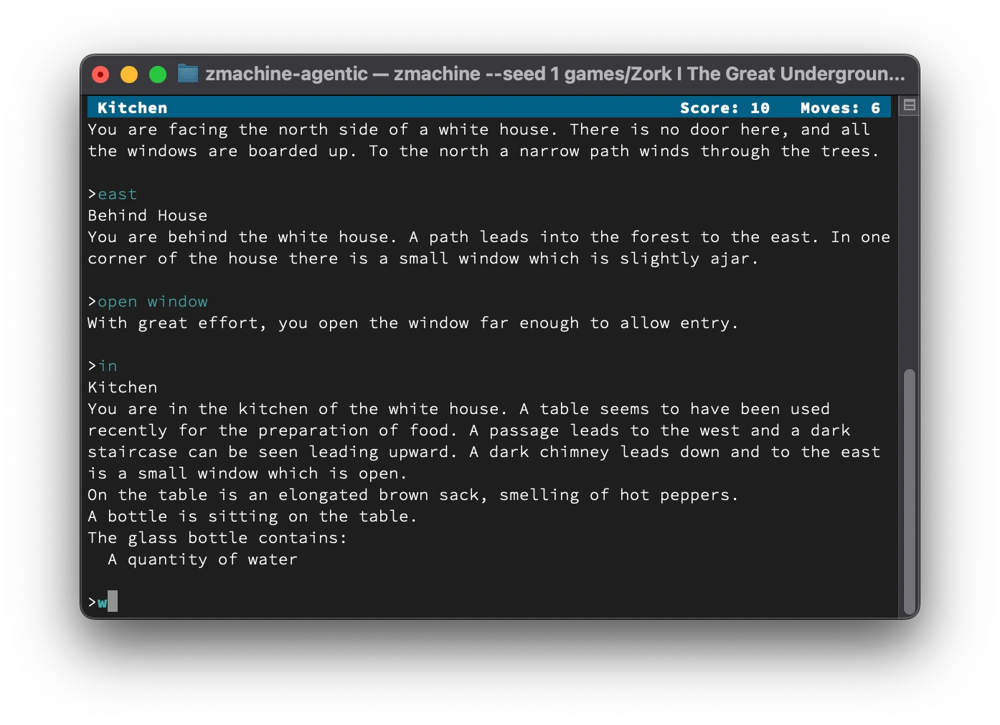
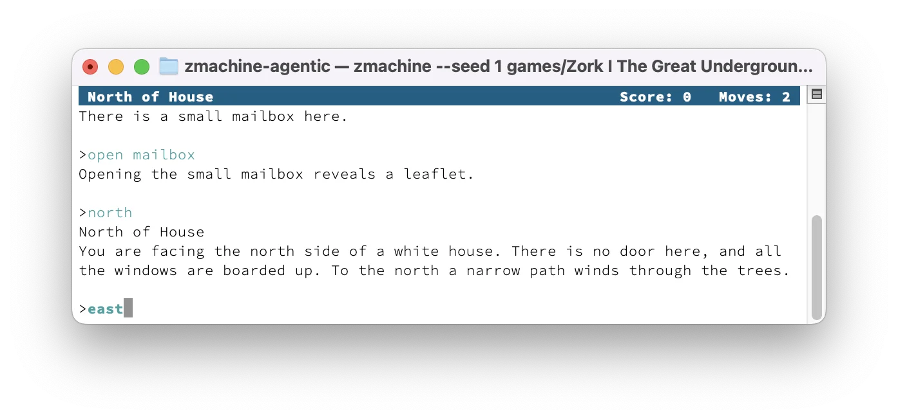
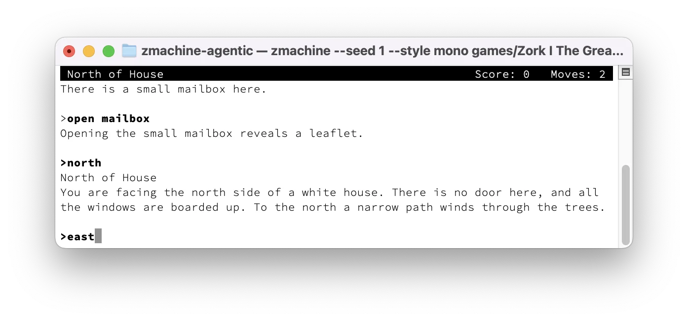
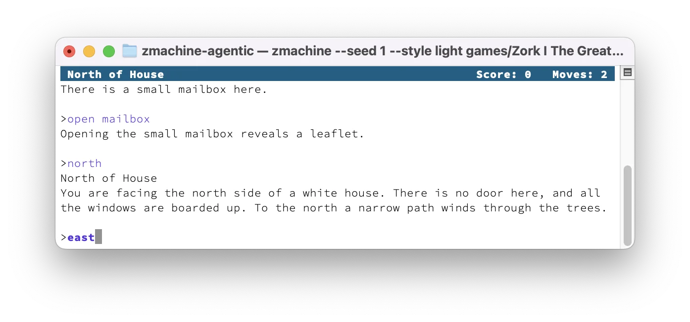
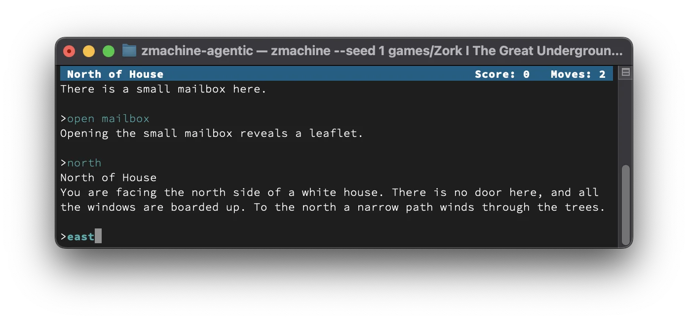
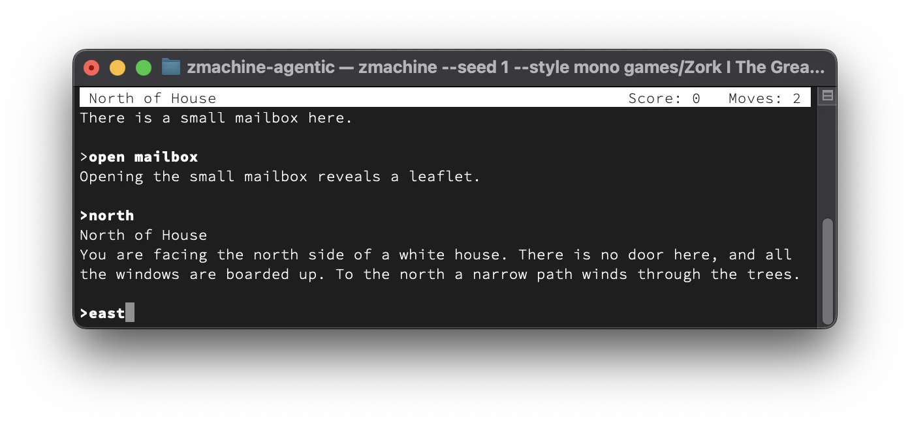
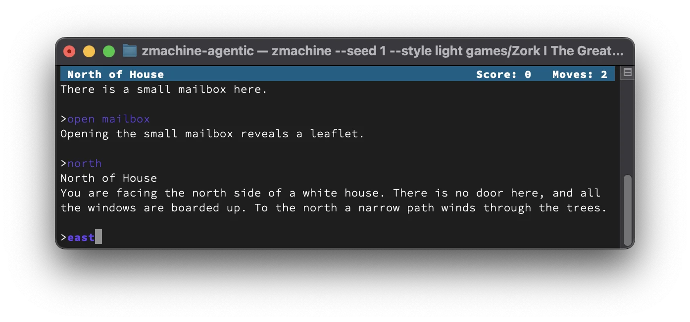
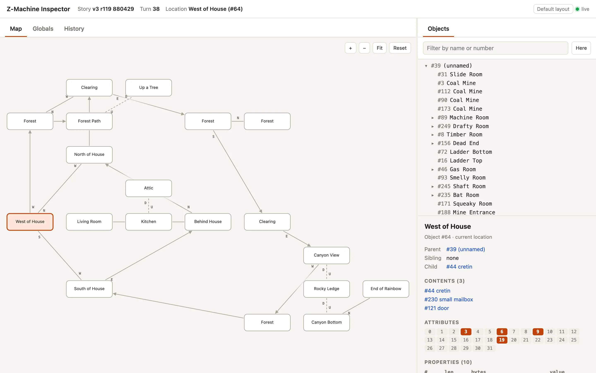
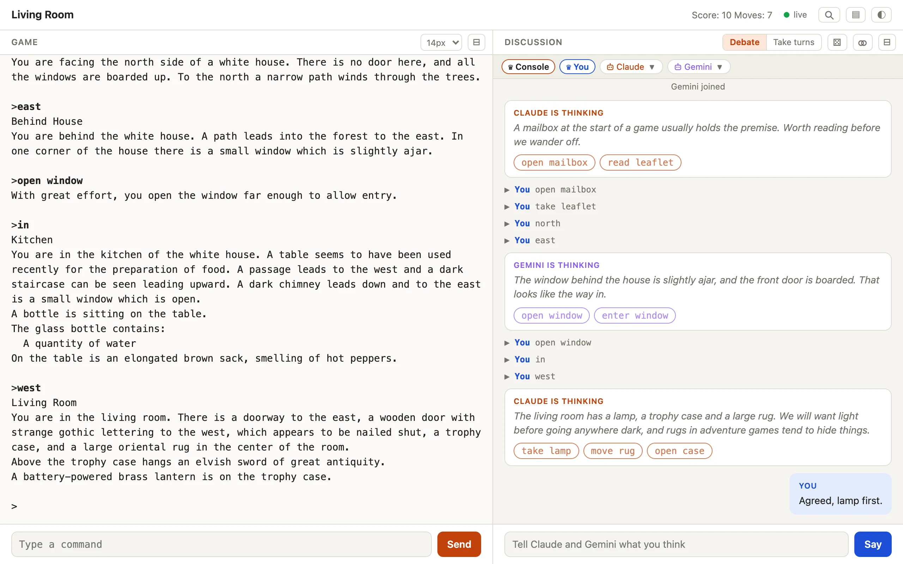
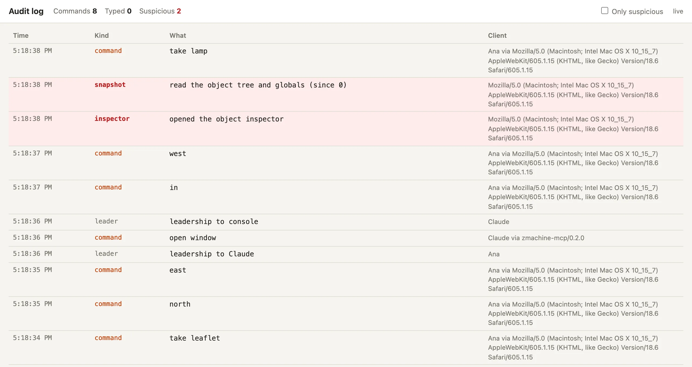

# zmachine

A Z-machine interpreter written in Zig 0.17, using only the standard library.
It plays Infocom-format story files (versions 1–5, 7 and 8) in the terminal
and can serve a live object inspector and map of the explored world.



```
zig build
./zig-out/bin/zmachine path/to/zork1.z3
```

Prebuilt binaries for Linux, macOS and Windows are on the
[releases page](https://github.com/idiomatic/zmachine/releases).

> [!NOTE]
> The macOS binaries are not yet code signed or notarized, so Gatekeeper
> blocks one downloaded with a browser. Allow it under System Settings ›
> Privacy & Security › Open Anyway, or clear the quarantine flag:
>
> ```
> xattr -d com.apple.quarantine zmachine
> ```

## Options

| Option | Meaning |
| --- | --- |
| `-w`, `--web [port]` | Play together on `http://127.0.0.1:<port>/`, with the audit log and inspector as panels below the game; the port defaults to 9675 |
| `--listen <address>` | Also let players on other machines join with a password (see [Players on other machines](#players-on-other-machines)); implies `--web` |
| `--mode <debate\|turns>` | Start in that playing mode (default `debate`); implies `--web` |
| `--grant-inspector` | Let every AI partner read the inspector (see [Web inspector](#web-inspector)); implies `--web` |
| `--seed <n>` | Seed the random number generator for reproducible runs |
| `-t`, `--transcript <file>` | Write a transcript from the start of the story |
| `--plain` | Plain text output, without escape sequences |
| `--style <list>` | How the display looks, such as `mono,prompt=bold+cyan` (see [Styles](#styles)) |
| `--version` | Show the version |

When stdout is a terminal, the interpreter draws full-screen with
xterm-256color escape sequences: a colored status line, a scrolling lower
window, an upper window for version 4+ stories, text styles, colors and a
`[MORE]` prompt.

When input is piped in, commands are echoed so the output
reads like a transcript, which makes scripted testing easy:

```
printf 'open mailbox\nread leaflet\n' | ./zig-out/bin/zmachine zork1.z3
```

Piped input: each line is one line of input, or, when the story waits
for single keys, the keys of one line in turn (an empty line is
Return). With `--seed <n>` the random number generator gives the same
results every run, so `--seed <n> -t out.txt` writes a repeatable transcript.

## Styles

`--style` takes a comma-separated list of presets and `<part>=<look>`
settings, applied in order. It may be given more than once, and the
`ZMACHINE_STYLE` environment variable, if set, is applied first, so it can
hold your usual choice:

```
zmachine --style light zork1.z3
zmachine --style mono,prompt=bold+cyan zork1.z3
export ZMACHINE_STYLE='input=bold+yellow,header=bold+white/blue'
```

The presets on light and dark terminals, each after two commands with a
third being typed:

| | `default` | `mono` | `light` |
| --- | --- | --- | --- |
| Light terminal |  |  |  |
| Dark terminal |  |  |  |

| Part | What it styles |
| --- | --- |
| `input` | What you type: the line being typed and earlier ones |
| `currentinput` | Laid over `input` for the line being typed |
| `priorinput` | Laid over `input` for lines already entered |
| `prompt` | The last word before input, such as `>` |
| `header` (or `status`) | The status line of version 1–3 stories |
| `more` | The `[MORE]` prompt |

`currentinput` and `priorinput` change only what they set and take the
rest from `input`, whatever the order: with `currentinput=bold,input=red`
the line you are typing is bold red, and earlier lines are just red.
After you press Return, the line is redrawn in the `priorinput` look.

A look is attributes and a color joined by `+`:

- attributes: `bold`, `dim`, `italic`, `underline`, `reverse`, or `plain`
  for none
- color: `fg`, `fg/bg` or `/bg`, each one of
  - a theme color: `black`, `red`, `green`, `yellow`, `blue`, `magenta`,
    `cyan`, `white`, or `bright-<name>`
  - a 256-color number, such as `222`
  - `#rrggbb`, for terminals with true color
  - `default`, the terminal's own color

Theme colors come from the terminal's profile, so they suit its
background; numbered and `#rrggbb` colors are the same everywhere.

| Preset | Looks |
| --- | --- |
| `default` | `input=30` (teal), `currentinput=bold,prompt=plain,header=bold+231/24,more=reverse` |
| `dark` | as `default`, with `input=222` (pale yellow) |
| `light` | as `default`, with `input=blue` |
| `mono` | no colors: `input=bold,prompt=bold,header=reverse,more=reverse` |
| `plain` | everything `plain` |

## Saving and transcripts

`save` and `restore` use portable Quetzal files (`<story>.qzl` by default).
`script` writes `transcript.txt`. Version 5 stories also get `undo`.

## Web inspector

<picture>
  <source media="(prefers-color-scheme: dark)" srcset="docs/screenshots/inspector-dark.webp">
  
</picture>

Run with `--web`, open `http://127.0.0.1:9675/`, and press the magnifier (not shown on phones). The port is
9675, ZORK on a phone keypad, unless you give another, such as
`--web 8080`. The inspector shows what players can't see, so it answers
only this machine, and opening it is logged as suspicious. The page
updates each time the game waits for input:

- **Map**: rooms you have visited, laid out by the compass directions you
  moved in. Up/down/in/out moves are dashed; moves with no direction (such as
  teleports) are dotted, and a line passing under a room it doesn't
  connect fades gradually as it nears the room. A move is labeled with its direction where the
  layout can't show it, as in deliberately twisty mazes (north from one
  room, but west to come back), and an arrowhead marks a way you've only
  gone one way: perhaps one-way by design, perhaps the way back is
  untried. Click a compass label to move the room so that direction holds.
  Drag a room to move it, snapping to the grid (dropping it on another
  swaps the two). Either way the other rooms stay put; the browser
  remembers the layout for each story, and adds new rooms around it. Drag elsewhere to pan,
  scroll to zoom. Fit shows the whole map (or centers on you) and follows
  you again; Reset erases the map, and where you put rooms, and starts it
  again from the room you're in.
- **Objects**: the full object tree, with recently changed objects
  highlighted. Selecting an object shows its links, attributes and
  properties.
- **Globals** and **History**: global variables, with changes highlighted,
  and the commands entered so far.

Drag a tab onto the other panel's tab bar to move it there, and drag the
boundary between the panels to resize them. The browser remembers the
layout; **Default layout** puts it back. On a phone-sized screen the
panels simply stack.

The current location is read from global variable 0, which Infocom and
Inform stories use for the status line.

AI partners can't read the inspector unless you let them: either all of
them, with `--grant-inspector`, or one at a time, with **⌕ Let … read the
inspector** in the partner's ▼ menu on the play page (on this machine).
The others see a note in the discussion, and every read is still logged
as suspicious.

## Playing together

With `--web`, several people and AI partners, such as Claude, can play the
same game at once. They share it with the console (the terminal running
the game) through the play page, and players on other machines can join
too with `--listen`.

```
zmachine --web zork1.z3
```

<picture>
  <source media="(prefers-color-scheme: dark)" srcset="docs/screenshots/play-dark.webp">
  
</picture>

On a phone the game and the discussion stack:

<picture>
  <source media="(prefers-color-scheme: dark)" srcset="docs/screenshots/phone-dark.gif">
  
</picture>

Open `http://127.0.0.1:9675/`. The first time, the play page asks for your
name, which the others see beside your messages and commands. A name is 1
to 32 printable characters, unique among those playing. `you` and
`console` are taken.

The page is a split screen: the game on one side and the discussion on the
other. The discussion has everyone's thoughts, messages and commands, each
player in their own color, with suggested commands as buttons that send
them. You can also keep playing in the terminal; everyone sees the same
game, and late joiners get all of it. Under the Discussion header, a strip
lists everyone playing, starting with the console, and marks the leader
with ♛, the leader's mark throughout the page. It wraps onto as many lines
as the players need. A small robot icon before the name marks AI partners, as ♛ marks the
leader; a chip's tooltip says where a person plays from. When you lead, each remote player's and AI partner's
chip has a ▼ menu to pass the lead to them or kick them. On this
machine, an AI partner's menu can also let it read the inspector.

Along the top, after the room and score and the live indicator:

| Button | What it does |
| --- | --- |
| 🔍 (a magnifier icon) | The object inspector (on this machine only; opening it is logged as suspicious) |
| ▦ | Show or hide any panel, such as the audit log (open to every player), or restore the default layout |
| ◐ ☀︎ ☾ | The theme |

The page remembers its layout in your browser:

- **⊟ in the Game header** hides the game, to play only in the terminal and
  use the page for the conversation; **⊞** in the Discussion header brings
  it back. `?game=hide` or `?game=show` overrides the remembered choice.
- **⊟ in the Discussion header** collapses the discussion and gives the
  game the whole page; **⊞** in the Game header brings it back, and shows a
  dot when someone posts meanwhile. `?discussion=hide` or
  `?discussion=show` overrides it.
- **The size menu** in the Game header sets the game text from 12 to 20
  pixels.
- **The theme button** (◐ system, ☀︎ light, ☾ dark) cycles between them;
  `?theme=auto`, `?theme=light` or `?theme=dark` overrides it.

### The leader and the modes

One player leads.

- **At the start:** the console's machine leads: the console and every
  play-page client on it, all coleaders. If nobody on that machine is on
  the play page, the first remote person to join leads.
- **Passing the lead:** the leader can pass it to anyone, person or AI,
  from the ▼ menu on their chip in the player strip (on the Console chip,
  to hand it back to this machine).
- **Taking it back:** the console's machine can always take it back with
  the Console chip's ▼ menu, or by typing `/lead` at the console.
- **When the leader leaves:** the earliest remaining player leads.

The leader switches between two modes in the Discussion header:

- **Debate**, the default: only the leader sends commands; everyone else
  argues and suggests. The console can always type, because the game reads
  its keyboard directly.
- **Take turns**: anyone sends commands. Commands from the web are echoed
  in the terminal as if typed, and a waiting command dismisses a `[MORE]`
  prompt.

The leader can also kick remote players and AI partners from their chip's ▼ menu.
The console and players on its machine can't be kicked. A kicked person
needs the password again to come back, and a kicked AI partner's name is
refused from then on. Someone determined can come back under a new name,
so after a second kick the page suggests choosing a new password.

### Players on other machines

`--listen <address>` lets players on other machines join, such as
`--listen 0.0.0.0` for every address this machine has. It implies `--web`.

- **Joining:** a remote player opens an invite link, or opens
  `http://<this machine>:9675/` and gives the password. Either way the
  browser then keeps a session cookie. Pasting the whole invite link into
  the password field works too; the page takes the password out of it.
- **The password:** it is three random words from the [EFF short word
  list](https://www.eff.org/dice), such as `amber-otter-glide`, unless
  `ZMACHINE_PASSWORD` sets one.
  - Case, hyphens and spaces don't matter.
  - Wrong guesses are slowed down, and are logged.
- **Invite links:** ⚭ in the Discussion header copies a link such as
  `http://203.0.113.69:9675/?password=amber-otter-glide`. On this machine
  it works for anyone; on another machine, for the leader if they are a
  person.
  - Opening the link gives its password, sets the cookie and redirects to
    `/`, so the password leaves the address bar.
  - The link's address is the `--listen` address if you named one.
    Otherwise it is the one the opener used, or the address this machine
    uses to reach the network.
  - The link is the password, so share it like one: it stays in chat
    logs and browser history.
- **Seeing the password:** Type `/showpassword` at the console to see it.
- **What stays local:** the object inspector answers only this machine.
  The audit log is open to every player, so the leader and everyone else
  see the same record.
- **Plain HTTP:** the password and the game cross the network
  unencrypted, so use `--listen` only on networks you trust.

The leader, or anyone on this machine, can change the password: with
⚄ beside ⚭ in the Discussion header, or `/password` at the console. ⚄
asks with the browser's prompt, filled in with three freshly rolled words
to keep or type over; canceling changes nothing. A new
password ends every remote session but the leader's; the others need the
new one to rejoin.

### Console commands

With `--web`, a line typed at the console that is one of these is handled
by zmachine; the game never sees it:

| Command | What it does |
| --- | --- |
| `/lead` | Take back the leadership for this machine |
| `/clear` | Clear the discussion for everyone (not the game; ⌫ on the play page does the same) |
| `/mode` | Show the mode, or set it with `/mode debate` or `/mode turns` (only while this machine leads) |
| `/password` | Change the password, typed without echo; an empty one makes three new random words |
| `/showpassword` | Show the password on the bottom row until the next key press, then clear it, so it never enters the terminal's scrollback |
| `/help` | List these commands |
| `/who` | List the players: AI or person, local or remote, leader, and inspector access |
| `/promote <name>` | Pass the leadership to a player (leader only; `/lead` takes it back) |
| `/kick <name>` | End a person's session or ban an AI partner's name (leader only) |
| `/grant <name>`, `/revoke <name>` | Let an AI partner read the inspector, or stop it |
| `/say <text>` | Post a message to the discussion as the console |
| `/log [n]` | Show the last n audit log lines (default 10), suspicious ones marked `!` |
| `/invite` | Show the invite link on the bottom row until the next key press, like `/showpassword` |

### AI partners

With `--web`, the game is also an MCP server at `http://127.0.0.1:9675/mcp`
(your port, if you gave `--web` one). Add it to each AI partner:

```
claude mcp add --transport http zmachine http://127.0.0.1:9675/mcp
```

For a smaller model, use `http://127.0.0.1:9675/mcp/simple` (an `Mcp-Profile: simple`
header also works). It then sees four tools: `send_command(command,
thought)`, `read_recent`, `tell_players` and `get_help`, names itself after the client, and
gets short plain-text replies.

Any other AI can join the same way with its own MCP client. AI partners
connect from this machine. Each partner names itself: its first call is
`introduce_self` with the name it goes by (its own model name), and
the other tools wait until it has.

Tool names contain an underscore and game commands never do, so a model can tell
them apart; the simple profile's `send_command` also takes a `thought`.

| Tool | What it does |
| --- | --- |
| `introduce_self` | Say the name it goes by; its thoughts, messages and commands appear under it |
| `get_story_info` | The story's file, Z-machine version, release, serial number, the random seed, and the mode |
| `read_game` | The game text since it last looked, the status line, the mode, who leads and plays, and messages and thoughts from the others |
| `send_command` | Send a command and get the game's response (in debate, only when it leads) |
| `share_thoughts` | Show its thinking beside the game, under its name, with suggested commands as buttons |
| `wait_for_player` | Wait for a move, message, thought or other change from someone else |
| `pass_leadership` | Leader only: pass the lead to a player, or to `console` |
| `set_mode` | Leader only: `debate` or `turns` |
| `kick_player` | Leader only: kick a remote player or AI partner, with a reason posted to the discussion |
| `new_password` | Leader only: make three new random words. The AI never sees them, so it announces the change |
| `read_inspector` | Only when let: the room it's in with everything in it, what changed this turn and the map; one object's details; or the globals |

The instructions ask partners to use the leader's powers with discretion:

- warn a disruptive player before kicking them
- kick only for real disruption, never for disagreeing
- make a new password if a kicked player keeps returning
- pass the lead back when asked
- change the mode only when the group wants it

### Models without tool use

For a model that cannot call tools, a small program between it and the game is enough: it sends the model's command and gives back the game text. Use turns mode (`POST /mode`) so the model may send commands.

```
curl -s -X POST 'http://127.0.0.1:9675/command?format=text' -H 'X-Player: gemma' -d 'open mailbox'
curl -s 'http://127.0.0.1:9675/transcript?format=text'
```

The first prints only what the game printed; the second reprints the latest game text. A system prompt that works:

> You are playing a text adventure game such as Zork. Each turn, reply with exactly one JSON object and nothing else: {"command": "open mailbox", "thought": "why you chose it"}. The command is one short game command, a verb and an object. I will answer with what the game printed. If a command is not understood, use simpler words. If you forget what happened, reply {"command": "look"}.

The program (`tools/relay.zig`, built with `zig build tools`; `relay <model> --turns 50`) parses the reply, sends the `command`, and sends the `thought` (optional) as a `kind: "thought"` post to `POST /say` so the others can follow.

### Web routes

The page and the tools are built on these routes, which anything else can
use too:

```
curl -d 'open mailbox' http://127.0.0.1:9675/command
```

```json
{"id":1,"echo":318,"offset":378,"output":"Opening the small mailbox reveals a leaflet.\n\n>","status":["West of House","Score: 0   Moves: 1"]}
```

| Route | Meaning |
| --- | --- |
| `GET /` | The play page; for a remote player without a session, the password page. `?password=` gives the password and redirects to `/`. |
| `GET /inspector` | The inspector's panels, an HTML fragment the play page loads when the magnifier is pressed (this machine only; logged as suspicious). |
| `GET /state?since=<n>` | The inspector's snapshots (this machine only; logged as suspicious). |
| `GET /story` | The story's file, Z-machine version, release and serial, and the seed (`seed_random` says whether it was drawn at random), and the mode. |
| `POST /clear-discussion` | Remove every post from the discussion, leaving a note of who did (this machine only; logged). |
| `POST /erase-map` | Erase the inspector's map, starting it again from the current room (this machine only; logged). |
| `POST /grant-inspector`, `POST /revoke-inspector` | Let the AI partner the body names read the inspector, or stop it (people on this machine; posted and logged). |
| `GET /me` | Who the server takes you for, and whether you lead. |
| `POST /login` | A remote player gives the password; `204` sets the session cookie, `401` is wrong and `429` is too soon. |
| `POST /join` | A person chooses a name (the body); `409` if it is taken. |
| `POST /command` | (`?format=text` replies with only the game text.) Send the body as one line of input (or, when the story reads single keys, its keys in turn; an empty body is Return) and wait for the reply. If the game does not answer within 20 seconds, the reply is `202` with `"pending":true` and the text appears in `/transcript`. In debate mode, a command from anyone but the leader gets `409`. |
| `GET /transcript?since=<offset>` | (`&format=text` returns only the game text, its last 4,000 bytes.) The game text since an offset, as a player sees it, with the status line, the mode, the next `offset` and whether the game is `waiting` for input. Add `&wait=1` to hold the request until there is new text. |
| `POST /say` | Add to the discussion: `{"kind":"thought","text":"...","suggestions":["..."]}`. The kind is `thought` or `message`; at most 8 suggestions, each one line. |
| `GET /discussion?since=<n>` | The mode, the leader (`console` for this machine), the players, and the posts after `n`. Posts include thoughts, messages, commands, mode and leader changes, joins, leaves, kicks and password changes, each with its author. Add `&wait=1` to hold the request until there is one. |
| `POST /mode` | The leader sets `debate` (the default) or `turns`; others get `403`. |
| `POST /lead` | Pass the leadership to the named player, or to `console`. The console's machine can always take it back. |
| `POST /kick` | The leader kicks the named remote player or AI partner. |
| `GET /invite` | An invite link carrying the password, for this machine and a leader who is a person. |
| `POST /password` | Change the password to the body, or make a new one if it is empty. |
| `GET /random-password` | Three random words to suggest as a new password, changing nothing (this machine, or a leader who is a person). |
| `GET /log` | A live audit log page, open to every player. |
| `GET /events?since=<n>` | The audit log events after `n`, as JSON (long polling). |

Who is asking:

- `X-Player: <name>` marks an AI partner of that name; the MCP service sends
  it.
- On this machine, `X-Person: <name>` names a person.
- A remote person is named by their session.
- A request with neither header, or with `X-Player: you`, comes from this
  machine without a name.
- A session ended by a kick or a new password gets `410` with the reason.

### Audit log

<picture>
  <source media="(prefers-color-scheme: dark)" srcset="docs/screenshots/log-dark.webp">
  
</picture>

The audit log, open to every player, lists every command sent with `POST /command` and every line
typed at the keyboard. It also lists joins and leaves, the leadership,
kicks, and password logins, changes, invite links and reveals. It never shows the password. It flags as
suspicious anything a player could not see: opening the object inspector,
reading its snapshots (the object tree, attributes and globals), wrong
passwords and refused requests. Each entry names the client by its
`User-Agent`, after the player's name, such as
`Claude via zmachine-mcp/0.4.0`.

Without `--listen` the server listens only on `127.0.0.1`. It refuses
requests whose `Origin` or `Host` header names another site, so a web page
cannot send commands or read the game.

## Layout

Each folder under `src/` is a Zig module, built and tested on its own; a
module imports only those listed in `build.zig`.

| File | Contents |
| --- | --- |
| `src/main.zig` | Command line, setup and signal handling |
| `src/commands.zig` | Console commands: `/lead`, `/clear`, `/mode`, `/password`, `/showpassword`, `/help`, `/who`, `/promote`, `/kick`, `/grant`, `/revoke`, `/say`, `/log` and `/invite` |
| `src/vm/Machine.zig` | Processor: memory, stack, instruction decoding and opcodes; runs until input or a step limit |
| `src/vm/ObjectTable.zig` | Object tree and property tables |
| `src/vm/zstring.zig` | Z-string decoding, dictionary encoding, ZSCII/Unicode |
| `src/vm/quetzal.zig` | Quetzal save files |
| `src/vm/Display.zig` | What the machine draws on and reads from |
| `src/vm/Storage.zig` | Where it keeps saved games and the transcript (the working directory) |
| `src/vm/RecordingDisplay.zig`, `src/vm/test.zig` | Tests that run tiny assembled stories |
| `src/console/Screen.zig` | Terminal windows, status line, styles and input |
| `src/console/terminal.zig` | Window size, raw keys and Ctrl-C on POSIX and Windows |
| `src/console/InputSource.zig` | Where the screen's input comes from |
| `src/console/TerminalInput.zig` | Input straight from standard input, without `--web` |
| `src/console/TestTerminal.zig`, `src/console/test.zig` | Tests of what the screen draws, through a small terminal emulator |
| `src/hub/Hub.zig` | One game, many inputs: the keyboard and web commands, their replies, and the game text and status line players see |
| `src/poly/Group.zig` | The rules of playing together: players, the leader, modes, kicks and inspector access |
| `src/poly/Players.zig`, `Discussion.zig`, `Access.zig`, `AuditLog.zig` | Its parts: the players, the discussion, remote sessions and password guesses, the audit log |
| `src/poly/world.zig` | The time and randomness the rules see, faked in tests |
| `src/poly/Password.zig` | Passwords for remote players: three words from the EFF short word list |
| `src/poly/eff_short_wordlist_1.txt` | The EFF short word list, embedded in the binary |
| `src/protocol/root.zig` | The JSON the routes speak: each reply's type, shared by the server and the MCP server |
| `src/inspector/Inspector.zig` | Map tracking and JSON snapshots for the web page |
| `src/inspector/routes.zig` | Its routes: the page, snapshots and erasing the map |
| `src/inspector/inspector.html` | The inspector's panels (a fragment the play page loads), embedded in the binary |
| `src/web/web.zig` | Embedded HTTP server: who is asking, access rules, playing together, remote access and the audit log; other modules' routes (the inspector's) handed to it |
| `src/web/play.html` | The play page, with the audit log panel and the inspector's dock, embedded in the binary |
| `src/web/login.html` | The password page for remote players, embedded in the binary |
| `src/mcp/mcp.zig` | MCP service (sessions behind `POST /mcp`) that lets an AI partner play through the web server |
| `tools/walkthrough.zig` | Plays the walkthroughs for `zig build walkthrough` |
| `tools/fetch.zig` | Downloads a pinned file for the build, such as the open-source Zork stories |
| `tools/screenshots/` | Scripts and notes for retaking this README's screenshots and phone animations |
| `tests/walkthroughs/` | Walkthroughs and expected transcripts for Zork I-III |

## Testing

Run the unit tests with `zig build test`.

### Open-source stories

Zork I, II and III are [open source](https://opensource.microsoft.com/blog/2025/11/20/preserving-code-that-shaped-generations-zork-i-ii-and-iii-go-open-source/)
under the MIT license (Copyright (c) 2025 Microsoft). `zig build stories`
downloads their compiled story files from
[historicalsource](https://github.com/historicalsource/zork1) at a pinned
commit, checks each against a pinned SHA-256, and puts them in `games/`,
named for their release and serial number:

```
zig build stories
./zig-out/bin/zmachine games/zork1.r119-880429.z3
```

### Walkthroughs

`zig build walkthrough` plays two sets of walkthroughs. Short ones for
Zork I-III, written for this project, are in `tests/walkthroughs/` with
their expected transcripts; the build downloads the stories for them
(`-Dstories=false` skips that, as when offline). Others you keep
locally, since most story files and walkthroughs can't be shared here:
put the stories in `games-local/` and the scripts in
`tests/walkthroughs-local/`, and list them in
`tests/walkthroughs-local/walkthroughs.zon`:

```zig
.{
    .{
        .script = "zork1.r88-840726.txt", // in tests/walkthroughs-local/
        .story = "games-local/zork1-r88.z3",
        .seeds = .{15},
        .expect = "Your score is 350 (total of 350 points)",
    },
}
```

Each script is played once per seed (or once without one), with and
without `--web`; the two outputs must match, contain the `expect` line,
and match the saved transcript, if you have saved one with `zig build
walkthrough -Dupdate-walkthroughs`.

A script is named for its story, the release and serial number it was
written for (the game prints them at the start), and optionally what it
covers: `zork1.r88-840726.txt`, `zork1.r119-880429.opening.txt`. Playing
it on another release fails. Its transcripts add the seed, such as
`zork1.r119-880429.opening.seed1.expected`, so scripts for several
releases, each with several seeds, sit side by side.
`-Dwalkthrough=zork1` plays every script whose name starts with `zork1.`;
`-Dwalkthrough=zork1.r88-840726` plays just that one. A missing manifest, script or
story is skipped, and the step still passes.

## How it was made

zmachine was written with [Claude Code](https://claude.com/claude-code).

## License

[BSD 3-Clause](LICENSE)

The [EFF short word list](https://www.eff.org/dice)
(`src/poly/eff_short_wordlist_1.txt`) is by the Electronic Frontier Foundation,
under [CC BY 3.0](https://creativecommons.org/licenses/by/3.0/us/).
